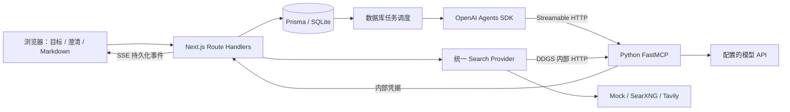

# ScenarioForge

先研究，再创作的 AI 项目工作区生成器。输入目标与约束、上传参考资料后，Agent 先公布文件计划，再通过 MCP 联网研究、整理证据，按场景生成中文 Markdown。你可以实时查看进度、回答澄清问题、编辑文档和下载 ZIP。

## 新成员快速上手

ScenarioForge 是一个本地运行的第一版 MVP。它有两个必须同时运行的服务：

- Next.js：网页、API、任务队列、SQLite 数据库和搜索适配器。
- Python FastMCP：研究工具、MCP 接口和模型调用。

两个服务共用项目根目录的 `.env.local`。模型令牌只在服务端使用，不会发送到浏览器。

### 1. 准备环境

需要 Node.js 22.12+、Python 3.11+、Git 和 `uv`。检查版本：

```powershell
node --version
npm --version
python --version
git --version
uv --version
```

没有 `uv` 时安装：

```powershell
python -m pip install uv
```

### 2. 安装依赖和数据库

```powershell
git clone https://github.com/Dmool-wyzy/ScenarioForge.git
cd ScenarioForge
npm install
Copy-Item .env.example .env.local
npm run db:generate
npm run db:deploy
cd mcp-server
uv sync --locked
cd ..
```

### 3. 配置 `.env.local`

至少填写项目专用模型令牌、模型地址、模型名和两个服务共用的内部令牌：

```env
OPENAI_API_KEY=项目专用模型令牌
OPENAI_BASE_URL=https://api.openai.com/v1
OPENAI_API_MODE=responses
SCENARIOFORGE_MODEL=服务商实际支持的模型名
SCENARIOFORGE_INTERNAL_TOKEN=至少32字符的随机字符串
```

生成内部令牌：

```powershell
node -e "console.log(require('crypto').randomBytes(32).toString('hex'))"
```

`OPENAI_API_KEY`、`OPENAI_BASE_URL`、`OPENAI_API_MODE`、`SCENARIOFORGE_MODEL` 和 `MODEL_TIMEOUT_SECONDS` 如果写在项目 `.env.local` 中，会覆盖系统同名变量。空的项目 key 会直接报错，不会回退到系统 key。修改配置后必须重启两个服务。

不要提交 `.env.local`、真实令牌、数据库、依赖目录、缓存或日志；`.env.example` 才是可以提交的配置模板。

### 4. 启动两个服务

窗口一：

```powershell
cd mcp-server
uv run main.py
```

默认 MCP 地址是 `http://localhost:8000/mcp`。

窗口二（项目根目录）：

```powershell
npm run dev
```

默认网页地址是 <http://localhost:3000>。开始研究前，两个窗口里的服务都必须保持运行。如果 PowerShell 找不到 `uv`，可运行 `mcp-server\.venv\Scripts\uv.exe run main.py`。

### 5. 第一次使用

输入目标和约束后提交；系统会先展示研究问题和文件计划，再搜索资料、提出澄清问题并生成 Markdown。回答澄清问题后研究才会继续。完成后可以预览、编辑、保存和下载 ZIP。基础文件是 `README.md`、`RESEARCH.md` 和 `SOURCES.md`，其他文件由场景决定。

上传支持 Markdown、UTF-8 TXT、含文本 PDF 和 DOCX；每个研究包最多 5 个文件，每个不超过 5 MB，每份提取文本最多 20,000 个字符。扫描版 PDF 不做 OCR。

## 小组协作

开始工作前同步主分支：

```powershell
git switch main
git pull --ff-only
```

为功能创建分支：

```powershell
git switch -c feat/简短描述
```

提交前查看 `git diff`，确认没有本地配置和数据库，再运行：

```powershell
npm run lint
npm run typecheck
git add .
git commit -m "说明这次修改"
git push -u origin feat/简短描述
```

建议通过 Pull Request 合并到 `main`，不要直接把未经检查的修改推到主分支。

## 常见问题

- **MCP 连接失败**：确认 Python 服务仍在运行，且两个服务的 `SCENARIOFORGE_INTERNAL_TOKEN` 完全相同。
- **模型连接超时**：检查 `OPENAI_BASE_URL`、模型名、API 模式和网络。项目不会在超时或 HTTP 错误后自动重试。
- **日志显示系统令牌**：确认项目 `.env.local` 中存在非空的 `OPENAI_API_KEY`，然后重启两个服务。
- **数据库迁移失败**：先停止 Next.js，再运行 `npm run db:generate` 和 `npm run db:deploy`。不要修改已提交的迁移文件。

新建数据库迁移使用：

```powershell
npm run db:migrate -- --name 描述这次修改
```

现支持项目级 RAG：来源版本、独立 Embedding、SQLite 向量检索、逐文件证据注入、可点击引用与证据索引导出。配置、迁移、架构、API/MCP、CLI 和测试见 [RAG 使用说明](docs/RAG.md)。默认 `RAG_ENABLED=false` 保持原流程，开启前需配置独立 Embedding。

## 开发环境

- Node.js 22.12+（当前开发环境为 Node.js 24）
- Python 3.11+、uv（MCP 服务阶段接入）
- SQLite 由 Prisma 管理，无需独立数据库服务

## 本地启动

```powershell
npm install
Copy-Item .env.example .env.local
# 编辑 .env.local，填写自己的凭据。
npm run db:generate
npm run db:deploy
```

安装 uv：`python -m pip install uv`。然后使用两个终端：

```powershell
# 终端 1：MCP Server
cd mcp-server
uv sync --locked
uv run main.py
```

```powershell
# 终端 2：Next.js
npm run dev
```

访问 <http://localhost:3000>。两个服务共用根目录 `.env.local`。首次 MCP 工具调用前需要 Next.js 已启动；两个进程的启动顺序不限。

模型配置优先读取项目根目录 `.env.local`：`OPENAI_API_KEY`、`OPENAI_BASE_URL`、`OPENAI_API_MODE`、`SCENARIOFORGE_MODEL` 和 `MODEL_TIMEOUT_SECONDS` 在文件中存在时覆盖系统同名变量。空的项目 key 会报错，不会回退到系统 key。未写入文件的配置仍可从环境变量读取；系统变量本身不会被修改。隔离测试可用 `SCENARIOFORGE_ENV_FILE` 指向独立配置文件，设为空字符串则仅使用测试进程环境。

本次工作环境的 uv 安装在项目虚拟环境中，可先执行 `mcp-server\.venv\Scripts\Activate.ps1`，再使用 `uv`。如果 PowerShell 限制激活脚本，可在 `mcp-server` 目录直接运行 `.venv\Scripts\uv.exe run main.py`。

新增迁移使用 `npm run db:migrate -- --name <name>`。

`.env.local`、数据库、依赖目录均不提交。模型与搜索凭据仅供服务端使用。

## 环境变量

| 变量 | 说明 |
| --- | --- |
| `OPENAI_API_KEY` | 模型 API key，仅在服务端使用 |
| `OPENAI_BASE_URL` | 默认 `https://api.openai.com/v1`，支持兼容中转站；填写纯 URL |
| `OPENAI_API_MODE` | `responses` 或 `chat_completions`，Next.js 与 Python 使用相同配置 |
| `MODEL_TIMEOUT_SECONDS` | Node.js 与 Python 模型请求超时，默认 120 秒，范围 10–300；Node 建连使用同一上限；超时/HTTP 错误不自动重试 |
| `SCENARIOFORGE_MODEL` | 所有业务模型调用的模型名，示例默认 `gpt-6-luna`；需确认你的服务商支持此名称 |
| `SEARCH_PROVIDER` | `mock`（默认）、`searxng`、`ddgs` 或 `tavily` |
| `SEARXNG_URL` | SearXNG 服务地址，仅 searxng 需要 |
| `TAVILY_API_KEY` | 仅 tavily 需要；其他搜索方式可以留空 |
| `TAVILY_MAX_RESULTS` | Tavily 单次结果上限，默认 5 |
| `MAX_SEARCH_RESULTS_PER_QUESTION` | 每个研究问题最多保留的搜索结果数，默认 5，范围 1–20 |
| `SEARCH_TIMEOUT_MS` | 搜索请求超时，默认 30000 毫秒，范围 1–120000 |
| `SCENARIOFORGE_MCP_URL` | 默认 `http://localhost:8000/mcp` |
| `DATABASE_URL` | 默认 `file:./dev.db`，相对 Prisma schema 所在目录，即 `prisma/dev.db` |
| `SCENARIOFORGE_INTERNAL_TOKEN` | 两个服务共享的内部凭据，至少 32 字符；不要使用示例占位值 |
| `SCENARIOFORGE_BACKEND_URL` | MCP 访问 Next.js 的地址，默认 `http://localhost:3000` |

生成内部凭据可运行 `node -e "console.log(require('crypto').randomBytes(32).toString('hex'))"`，将输出填入 `.env.local`。禁止设置任何 `NEXT_PUBLIC_*` API key。

首页、已有文件预览和下载不依赖外部 API key；开始或继续研究时会检查配置。中转站需支持所选模式的 API 和 function/tool calling。Chat Completions 模式通过强制函数调用和本地 JSON Schema 校验获得结构化结果；Responses 模式使用 JSON Schema Structured Outputs。不会静默切换模式或替换模型名。

## 搜索 Provider

通过根目录 `.env.local` 的 `SEARCH_PROVIDER` 切换搜索服务。可以从 `.env.example` 复制搜索配置块到已有 `.env.local`，保留自己的模型、数据库和内部凭据；修改后重启 Next.js 和 Python MCP 服务。未设置时使用 mock，不需要 Tavily key；Mock 仅替代搜索，研究规划与证据整理仍需要模型凭据。

| Provider | 是否需要 key | 适用场景 |
| --- | --- | --- |
| mock | 否 | 本地开发、离线搜索测试，不消耗搜索额度 |
| searxng | 否 | 推荐：自建免费搜索；实例需启用 JSON 输出 |
| ddgs | 否 | 免费搜索，依赖 Python MCP Server 的 DDGS endpoint |
| tavily | 是 | 使用 Tavily Search API |

### 使用 SearXNG

已有服务时，在其 `settings.yml` 中设置 `search.formats: [html, json]`，重启后配置：

```env
SEARCH_PROVIDER=searxng
SEARXNG_URL=http://localhost:8888
```

本地 Docker 示例（需已安装并启动 Docker）：

```powershell
New-Item -ItemType Directory -Force .tmp/searxng | Out-Null
@'
use_default_settings: true
server:
  secret_key: "local-development-change-this-secret"
  limiter: false
search:
  formats:
    - html
    - json
'@ | Set-Content -Encoding utf8 .tmp/searxng/settings.yml
docker run --rm --name scenarioforge-searxng -p 127.0.0.1:8888:8080 -v "${PWD}/.tmp/searxng:/etc/searxng" docker.io/searxng/searxng:latest
```

这个示例仅绑定本机；部署共享实例前更换 secret_key 并配置访问与限流。若搜索返回 403，检查 JSON 输出和实例访问权限。

### 使用 DDGS

```env
SEARCH_PROVIDER=ddgs
SCENARIOFORGE_MCP_URL=http://localhost:8000/mcp
```

在 `mcp-server` 执行 `uv sync --locked`、`uv run main.py`。DDGS 已列入 Python 依赖；Next.js 使用共享内部凭据调用 `POST /internal/search/ddgs`。endpoint 与 MCP 使用同一主机及端口，内部凭据沿用 `.env.local` 的 `SCENARIOFORGE_INTERNAL_TOKEN`。DDGS 可能被上游限流；失败或空结果会明确报错，不补造来源。

每个研究问题生成简短的互补查询。某条查询超时或无结果时，会尝试本轮其余查询（最多 3 条），不重新调用模型生成查询；已有来源可继续整理为证据。所有查询均失败时停止本轮，鉴权、配置或限流错误则立即停止。`SEARCH_TIMEOUT_MS` 是单条查询的搜索预算，Next.js 调用本地 DDGS endpoint 时额外留出 5 秒接收结构化错误。

### 使用 Tavily

```env
SEARCH_PROVIDER=tavily
TAVILY_API_KEY=tvly-your-key
```

仅此 Provider 检查 Tavily key；401/403 提示检查 key，429 提示限流或额度不足。`TAVILY_MAX_RESULTS` 是 Tavily 的额外上限，实际请求取它与本次请求数量的较小值。

### 确认当前 Provider 与故障表现

研究时间线显示 `[provider]`、实际查询词及结果数量。持久化的 `search_started` / `evidence_found` 事件还包含 query、provider、fetchedAt，失败时有 `search_failed` 的 code 和中文原因；可通过研究包快照或 SSE 查看。

Mock 固定返回最多三条 `https://example.com/mock/...` 示例，每条带 `[MOCK SEARCH RESULT]`，证据会强制标为低置信度、待确认。真实 Provider 失败时不会回退到 Mock；Agent 得到搜索不可用的明确提示，未成功完成检索与证据保存的问题不会通过正文生成校验。已有文件仍可查看和下载。

## 架构



Next.js 统一管理数据库和文件版本；Python 通过受保护的内部接口读写研究包。工作区存放在数据库中，下载时生成文件或 ZIP，不提供任意本地文件系统访问。

## MCP 工具

| 工具 | 用途 |
| --- | --- |
| `create_research_package` | 创建或复用研究包，规划研究问题与文件清单 |
| `search_scenario` | 改写查询、搜索、去重并整理带来源的证据卡 |
| `generate_workspace` | 综合证据，按已公布的文件计划生成文档 |
| `update_file_plan` | 为研究中发现的新主题追加文件计划或完善用途说明 |
| `ask_user` | 发起文本、单选或多选澄清问题 |
| `get_user_answers` | 获取答案、等待或应用超时策略 |
| `read_workspace_file` | 获取最新文件内容和版本 |
| `write_workspace_file` | 带版本校验写入文件，遵守锁和用户原文保护 |
| `export_workspace` | 返回 ZIP 下载地址和文件列表 |
| `get_research_package` | 读取结构化问题、状态、证据统计、文件元数据和澄清 |
| `search_evidence` / `get_evidence` | 项目内向量检索与完整证据回查 |
| `get_file_context` | 取得指定计划文件的有界 RAG 上下文与保存元数据 |
| `answer_user` | 从 CLI 或下游 MCP 客户端提交澄清回答 |
| `update_workspace_file` | `write_workspace_file` 的兼容别名，遵守同样的版本、引用及用户保护 |

工具检查说明见 [mcp-server/README.md](mcp-server/README.md)。

## 工作区与限制

- 必须输出：`README.md`（概览与导航）、`RESEARCH.md`（研究与证据）、`SOURCES.md`（来源索引）。
- 其他文件按场景选择，例如 `DECISIONS.md`、`PLAN.md`、`TODO.md`、`RISKS.md`、`DATA_MODEL.md`、`API_DESIGN.md`、`EXPERIMENT_PLAN.md`、`BUDGET.md`、`TIMELINE.md`；示例不是必选清单。简单场景可仅生成三份基础文档。
- 生成前展示名称、用途、优先级（required / recommended / optional）和内容要点。只将确实准备生成的文件列入计划，每份职责明确，避免重复或凑数量；优先级表示重要程度，完成时检查当前计划中的全部文件。
- 研究中可先追加文件计划，再创建新文件。单包计划最多 20 项；文件名使用英文字母开头的字母、数字、下划线或连字符，以 `.md` 结尾，禁止目录和系统保留名。
- 上传：最多 5 个文件，每个不超过 5 MB；支持 MD、UTF-8 TXT、含文本的 PDF 和 DOCX；每份提取文本最多保留 20,000 字符。扫描 PDF 不包含 OCR。
- 每包最多 12 次新检索，通过计划中问题的编号（从 0 开始）关联证据和进度。已完成的问题直接复用证据，不扣额度、不调用模型；计数达到 12 后仍可生成文件。每次生成 2–3 个简短查询，每个查询默认最多 5 个结果；达到结果上限后停止补充查询。
- 每包最多 2 轮澄清、共 6 个问题；默认等待 600 秒；每个 Agent 执行轮次最多 24 步、20 分钟。
- 编辑锁每 30 秒续期，无续期时 120 秒后释放。未保存草稿存放在当前浏览器窗口的 sessionStorage。
- 用户最后保存的全文受到保护。Agent 可以追加保留原文的建议；整包重新生成会保留用户已编辑的文件。
- 未启用 RAG 时也逐文件生成、逐文件保存，每次工具调用最多处理三份文件；`SOURCES.md` 直接整理已保存的真实来源，不调用模型。中断后复用已有证据和当前内容的检查点，继续缺失文件。单次模型请求默认等待 120 秒，模型超时、限流或连接失败均不自动重试，可通过 `MODEL_TIMEOUT_SECONDS` 设置 10–300 秒。
- 本地常驻 Node.js 服务每 3 秒扫描任务，最多运行两个研究包；任务租约支持进程退出后恢复。此 MVP 按本地常驻进程运行方式实现。
- 无登录；研究包链接包含随机 ID，应作为私人链接保存。MCP 默认仅监听本机。

## 验证

```powershell
npm run lint
npm run typecheck
npm run check:model-transport
npm run check:model-config
npm run build
npm run check:search
npm run check:ddgs

# 本地 MCP 慢调用、失败停止及取消回归；包含 61 秒等待，不调用付费 API。
npm run check:agent-tools

# 需要 Next.js 已启动；验证后自动删除临时研究包。
npm run check:integration

# 默认使用已安装的 Edge，无需安装浏览器。
npm run check:browser

# 使用独立数据库、构建目录及本地模型/搜索夹具，不调用付费 API。
# 如果 3000 已有开发服务，可先设置 $env:AGENT_E2E_PORT="3001"。
npm run check:agent
```

其他平台可设置 `PLAYWRIGHT_CHANNEL=chrome`，或调整 Playwright 配置使用自己安装的浏览器。`check:agent` 需要已经安装 MCP Python 依赖，使用 `.tmp/agent-e2e.db` 和 `.tmp/next-agent-build`，占用本机 `AGENT_E2E_PORT`（默认 3000）、8001、9009 端口；同一套 Agent 测试应顺序运行。

真实研究需要可用的模型凭据，以及一个可用的真实搜索 Provider；只有选择 tavily 时才需要 Tavily key。夹具测试使用正式 Mock Provider 验证调用链路和状态协调，不能验证服务商的模型可用性或真实研究质量。`check:integration` 预期连接以 mock 启动的 Next.js；`check:agent` 在隔离环境中强制使用 mock，不依赖本机搜索配置。

## 文档

- [三个示例输入](docs/EXAMPLES.md)
- [演示脚本](docs/DEMO.md)
- [实现与开发说明](docs/DEVELOPMENT.md)
- [阶段交付与验收记录](docs/VALIDATION.md)
