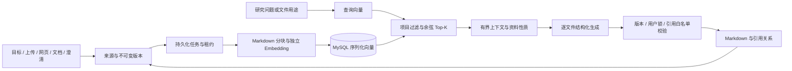

# 项目证据库与 RAG

RAG 收录目标、上传文本、搜索摘要、公开链接正文、工作区 Markdown 和澄清回答。逐文件生成前检索相关分块，模型接收有界上下文，关键结论使用 `[EVIDENCE-n]` 引用。旧证据卡 `E001` 保留，与分块编号不同。

浏览器用户先登录并加入团队项目，才能访问项目中的研究包和证据。RAG 检索继续按研究包隔离，尚未合并同一团队项目下不同研究包的索引。当前默认 `RAG_ENABLED=false`，真实模型、搜索及 Embedding 需要配置后另行验收。



## 配置与启用

在 `.env.local` 中填写独立配置。聊天中转支持 Chat/Responses 不代表支持 `/embeddings`；模型名以服务商提供的实际名称为准。

```env
RAG_ENABLED=true
EMBEDDING_PROVIDER=openai_compatible
EMBEDDING_BASE_URL=https://your-provider.example/v1
EMBEDDING_API_KEY=填写项目专用的Embedding凭据
EMBEDDING_MODEL=填写服务商支持的Embedding模型
```

`EMBEDDING_API_KEY` 不回退至 `OPENAI_API_KEY`。如复用项目专用聊天 key，需明确填入此字段；不要使用系统里其他项目的 key。所有配置仅供服务端使用，不传到浏览器、导出文件或检索日志。

| 可选变量 | 默认值与约束 |
| --- | --- |
| `EMBEDDING_DIMENSIONS` | 默认不传，记录首次返回维度；指定时 1–8192，服务商须支持 |
| `EMBEDDING_BATCH_SIZE` | 16，范围 1–64 |
| `EMBEDDING_TIMEOUT_MS` | 30000，范围 1000–120000；SDK 不额外自动重试 |
| `RAG_CHUNK_SIZE` | 800 字符，范围 500–1000 |
| `RAG_CHUNK_OVERLAP` | 120，须为块大小的 10%–20% |
| `RAG_TOP_K` | 5，范围 1–20 |
| `RAG_MIN_SCORE` | 0.25，范围 -1–1；依实际模型效果调整 |
| `RAG_MAX_CONTEXT_CHARS` | 10000，范围 1000–30000，控制检索证据总字符数 |

`RAG_ENABLED=false` 保留原生成流程。开启后如缺少 Embedding 配置，后台在调用研究模型前停止。`EMBEDDING_PROVIDER=mock` 仅用于离线开发，使用确定性哈希向量，不代表真实语义检索效果。

## 迁移与旧包回填

先备份当前 MySQL 数据库并停止写入，确认 `DATABASE_URL` 指向目标数据库，再应用已提交的 MySQL 迁移。Windows 如 Prisma 引擎被占用，先停 Next.js。

```powershell
npm run db:generate
npm run db:deploy
npm run rag:backfill
npm run rag:backfill -- --apply
# 仅一个包可追加 --package=<研究包ID>
```

回填默认 dry-run；`--apply` 只收录已有资料并建立任务，不调用 Embedding、不重新搜索、不生成文档。重复回填跳过已有来源，保留实时资料版本。配置完成并启动服务后，展开“证据与检索”点击“重建索引”。后台也会处理持久化的待索引任务。

当前 MySQL schema 包含研究问题、来源、不可变来源版本、分块、索引代次、向量、引用、任务及检索日志，长文本和序列化数据已适配。`rag:backfill` 只处理当前数据库中已经导入的资料，不会自动搬运 SQLite 文件或分配项目归属。

历史 SQLite 增量迁移保存在 `prisma/sqlite-migrations`；`scripts/check_migration.py` 是对应的 SQLite 副本验证脚本，不是当前 MySQL 迁移验证器。导入旧数据前先备份并确认目标项目、成员和研究包归属；未设置 `projectId` 的匿名旧包不会通过网页成员鉴权。

索引按来源版本和分块配置去重，证据编号在项目内递增、不因重建而重用。索引记录提供商、模型、端点指纹、维度和分块版本；不兼容时要求重建。新代次全部完成才切换，失败保留旧索引和原文。检索只读当前来源版本，历史证据仍能回查。

## API 与 MCP

以下浏览器 API 均要求登录及所在项目的成员权限。MCP 通过内部令牌访问，仍由服务端校验研究包作用域。

| API（相对 `/api/research/<id>`） | 用途 |
| --- | --- |
| `GET /evidence?page=1&sourceType=upload` | 每页 20 条证据预览，可过滤类型 |
| `GET /evidence/EVIDENCE-12` | 完整分块、来源、抓取时间、版本和引用文件 |
| `POST /evidence/search` | `{query, topK?, sourceTypes?}` 项目内向量检索 |
| `GET /knowledge` | 来源/分块/向量数、模型、维度、索引状态 |
| `POST /knowledge/rebuild` | 幂等回填并持久化索引任务 |
| `POST /sources` | `{url, title?}` 抓取公开 HTML/TXT/Markdown |

链接抓取限制标准 HTTP(S) 端口、公开 IPv4、连接固定已验证 IP、逐跳检查重定向、15 秒超时及 2MB 响应。拒绝本机、内网、保留地址和携带凭据的 URL；不执行 JavaScript。可通过 API 添加链接，当前没有单独链接输入表单。

新增 MCP 工具 `get_research_package`、`search_evidence`、`get_evidence`、`get_file_context`、`answer_user`、`update_workspace_file`，保留原工具。统一使用 `package_id`，不接受冲突别名；内部 Agent 强制绑定当前包。

`get_research_package` 返回结构化问题（稳定 ID、问题、查询、优先级）、状态、文件元数据、统计及澄清。独立调用 `create_research_package` 异步排队，立即返回 packageId；内部 Agent 复用已有 package_id。`search_scenario` 支持 question_id，兼容旧 question_index 和完全一致的问题文本；内部 Agent 固定用计划下标，避免改写导致重复扣额度。

手动更新文档先调用 `get_file_context(package_id, filename)`，使用返回的 `rag`、最新 `previousFile.version`，再调用 `write_workspace_file` 或别名 `update_workspace_file`。新文件须先发布文件计划。保存会校验当前索引、contextVersion、文件版本、编辑锁、用户原文和本次检索的引用。用户手动编辑可以保存尚未解析的引用，系统记录警告。

## CLI

```powershell
npm run cli -- create "我要做一个基于 YOLO 的安全帽检测项目"
npm run cli -- get <packageId>
npm run cli -- search <packageId> "数据集标注类别和许可证"
npm run cli -- evidence <packageId> EVIDENCE-12
npm run cli -- clarify <packageId>
```

`clarify` 打印待答问题、选项、原因及默认假设，等待终端输入后调用 `answer_user`，空行跳过。Next.js/MCP 须已启动。阻塞问题按原策略暂停、超时或采用明确的未确认默认假设；回答入库后恢复研究。

CLI／MCP 是持有内部令牌的可信服务入口。本轮未增加 CLI 的团队项目选择流程；独立创建的研究包若没有项目归属，须显式绑定目标项目后才能从网页访问。

## 引用与恢复

生成按文件串行检索和保存，后续文件失败不回滚已有文件。恢复时保留用户编辑，跳过在最新外部资料/澄清之后已生成的文件。需要修订已有内容时，可使用逐文件读取、检索和版本保存工具。

证据不足返回 `insufficient_evidence`，文档须标注“待确认：当前证据不足”。无效、当前项目不存在或本次未检索到的编号均不能通过生成保存校验。引用预览跳过代码块/行内代码，不开启 HTML。

索引任务有租约、心跳和持久化批次。网络型故障最多 3 次尝试并增加间隔；无效向量/维度冲突立即停止，不自动换模型。修复后点“重建索引”。日志记录 query、Top-K、编号、分数和耗时，不记录密钥。SSE 包含来源收录、证据索引、问题完成、检索完成、索引失败/重建提醒，以及工具开始/结束/失败。

ZIP 保留原工作区文件，额外提供 `evidence-index.json`：可离线回查原文、来源、版本和引用；不导出向量或 key，不重写用户的 SOURCES.md。

## 验证与限制

```powershell
npm run check:rag
npm run check:rag-agent
npm run check:agent
npm run lint
npm run typecheck
npm run build
```

`check:rag`、`check:rag-agent`、`check:agent` 要求 `SCENARIOFORGE_TEST_DATABASE_URL` 指向独立 MySQL 测试库，库名以 `scenarioforge_test_` 开头；不要指向应用数据库。`check:rag` 使用确定性假 Embedding，验证东京合租、YOLO 安全帽、社团活动、隔离、去重、版本、引用、租约和重建失败。`check:rag-agent` 使用真实 SDK、HTTP MCP、Next.js、浏览器，模型／Embedding／搜索均为本机夹具，验证两种 API 模式和原功能。完整链路运行前需释放 3000、8001、9009 端口，不使用真实供应商 key。

MySQL 以序列化文本持久化向量，Node.js 每页 200 条做精确余弦扫描；本次切换存储未改检索算法，尚无大规模容量／延迟基准。tokenCount 是 UTF-8 字节估算，不是模型 tokenizer。长表格／代码按行延续并补表头／围栏，极长单行仍可能超过普通块目标。有效编号不代表结论必然成立；语义支持度、来源质量、摘要是否足够、真实服务商 Embedding 可用性仍需真实资料验收。AI 内容和超时假设有性质标记，不能当作独立已验证事实。
