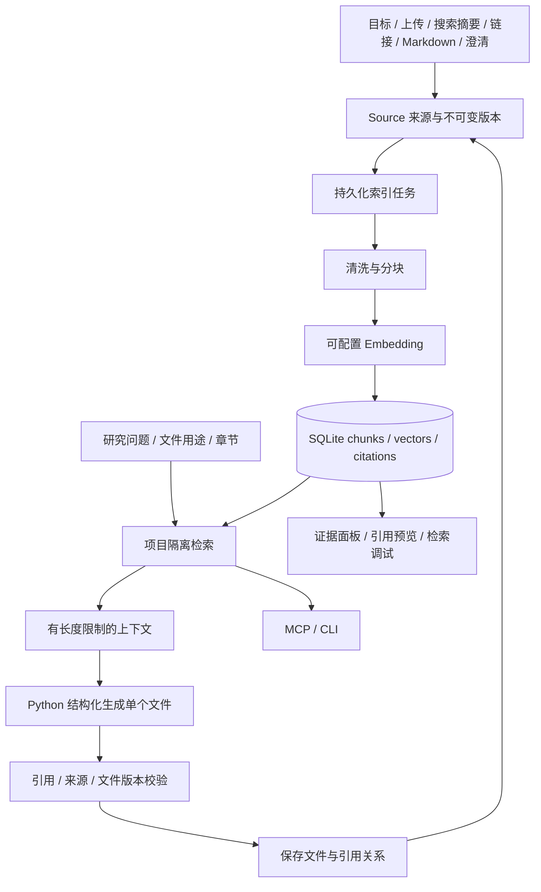

# ScenarioForge 项目证据库改进计划

状态：待确认，尚未实施业务代码、数据库迁移或 Embedding 调用。
依据：`IMPROVE.md`；已核对 README、Prisma 模型、搜索、研究、任务、澄清、编辑、生成、导出、前端与 MCP 实现。

## 现状与实施边界

现有系统是 Next.js 管理数据库与任务、Python FastMCP 调用模型的本地应用。四种搜索 Provider、结构化计划、带来源证据卡、SSE、澄清恢复、文件计划、版本冲突与用户原文保护已经存在，应增量扩展。

目前 `Evidence` 保存的是综合判断与来源摘要，不是可检索的原始 chunk；上传文本、澄清、Markdown 各自保存，没有统一索引。`generate_workspace` 一次传入整包证据并生成所有文档，尚无按文件检索、chunk 引用校验或引用预览。现有 MCP 提供研究与文件操作，缺少证据检索与证据详情工具。

刚修复过的问题必须纳入回归：研究问题改写引发重复检索、12 次额度触顶、MCP 60 秒默认超时、DDGS 间歇失败、严格参数 Schema。升级不能通过重新搜索已有问题补索引，也不能自动启动付费研究。

不增加用户系统、支付、团队权限、目录扫描或独立云向量数据库。既有文件和链接继续可读、可编辑、可导出。

## 推荐架构

首版使用 **SQLite 保存向量，Node.js 按项目读取并计算余弦相似度**。向量以 JSON 文本持久化，应用内使用数值数组；不依赖 SQLite 扩展或另一个常驻服务，便于当前 Windows 环境运行。通过 `VectorStore` 接口隔离，以后数据规模需要时可替换实现。首版按项目分页扫描有效向量，空间复杂度受批次和 Top-K 限制；不能描述为已有近似最近邻索引。

数据库、索引、检索与引用校验统一位于 Next.js。Python 通过内部 API 获取检索上下文、生成结构化结果，避免两端分别维护向量库。

## 数据模型与迁移

保留 `ResearchPackage`、`Evidence`、`WorkspaceFile`、`Clarification`、`ResearchEvent` 及旧字段。沿用现有 Prisma 命名，不重命名已有表。JSON 数据沿用 SQLite 中的 `String` 序列化，服务层使用 Zod 校验。

| 模型 | 建议字段与约束 |
| --- | --- |
| `ResearchQuestion`（新增） | `id/packageId/ordinal/question/searchQueries/priority/status/attemptCount/lastError`；唯一 `(packageId, ordinal)`；引用使用稳定 ID，正文可修改但 ID 不随措辞变化 |
| `Source`（新增） | `id/packageId/sourceType/sourceKey/title/url/metadata/currentRevisionId/createdAt/updatedAt`；唯一 `(packageId, sourceKey)`；类型为 web/upload/workspace/clarification |
| `SourceRevision`（新增） | `id/packageId/sourceId/rawContent/contentHash/revision/fetchedAt/metadata`；唯一 `(sourceId, contentHash)`；引用关联不可变版本，防止改文档后旧引用失效 |
| `EvidenceChunk`（新增） | `id/packageId/sourceRevisionId/chunkIndex/evidenceNumber/content/tokenCount/metadata/createdAt`；唯一 `(packageId, evidenceNumber)` 和 `(sourceRevisionId, chunkIndex)`；显示为 `[EVIDENCE-n]`，不复用编号 |
| `EmbeddingIndex`（新增） | `id/packageId/generation/provider/model/baseUrlFingerprint/dimensions/chunkerVersion/status/createdAt/activatedAt`；`ResearchPackage.activeIndexId` 指向可检索代次；不存 API key |
| `ChunkEmbedding`（新增） | `id/packageId/indexId/chunkId/vector/vectorNorm`；唯一 `(indexId, chunkId)`；验证维度、有限数值及模型一致性 |
| `Citation`（新增） | `id/packageId/chunkId/documentName/fileVersion/section/createdAt`；唯一 `(packageId, documentName, fileVersion, section, chunkId)` |
| `KnowledgeJob`（新增） | `id/packageId/sourceRevisionId/indexId/jobKey/status/attempts/nextAttemptAt/leaseOwner/leaseUntil/errorCode`；唯一 `jobKey`，支持故障恢复与重复提交去重 |
| `RetrievalLog`（新增） | `id/packageId/query/topK/sourceTypes/indexId/resultEvidenceIds/scores/durationMs/status/createdAt`；记录必要调试信息，不记录 key 或完整 Prompt |
| 既有表增量 | `ResearchPackage` 加 `activeIndexId/nextEvidenceNumber/planVersion`；`Evidence` 加可空 `questionId`，保留现有证据卡；`WorkspaceFile` 加 `contextVersionUsed` 用于生成并发校验 |

关联关系同时校验 packageId；需要跨表隔离的关联使用组合唯一键与组合外键，服务层所有读取也必须带 packageId，不能只凭 chunkId 查询。

迁移分两步，均不调用外部 API：

1. `rag_foundation`：新增表、可空字段、唯一约束、项目/状态/任务租约索引。现有六张业务表的数据保留，不改变旧状态值。
2. `backfill-rag` 显式脚本：从已保存计划、上传、搜索事件、证据来源、工作区和回答建立问题、来源、版本与待索引任务。幂等、支持 dry-run 与进度检查点；先在数据库副本验证，再备份并应用到当前数据库。不能根据相似措辞自动把历史证据认定为某个问题已完成；只迁移明确关联，歧义记录单列人工审查。

Embedding 在后续显式启动的索引任务中执行。老包可继续阅读；未建索引时显示未索引，不把全量上下文冒充 RAG。新功能优先用新状态字段表达索引状况，不把 `waiting_for_edit`、`blocked` 等旧状态强行删成五种；外部 MCP 如需简化状态，提供 `status + detailedStatus` 映射。

回滚先关闭 RAG 功能开关、停止索引任务，继续旧链路读取。真正回退数据库需恢复已备份的 SQLite 文件与匹配代码，不能删除新表假装无损回滚。

## RAG 模块设计

### 清洗、分块与去重

- 默认目标 chunk 800 字符、重叠 120 字符；普通文本允许约 500–1000 字符，按句子/段落取边界。`tokenCount` 使用模型可用 tokenizer；未提供 tokenizer 时明确标注为估算，不冒称精确 token 数。
- Markdown 按标题层级、段落、列表分块；表格、代码块优先整体保留。超长表格按行分块且重复表头；超长代码按行切分并补围栏，记录 `continued`；完整条款优先保留，超过硬上限时标记延续关系。
- metadata 保存标题路径、原文偏移、URL、文件名、版本、研究问题 ID、抓取时间和内容类型。搜索摘要与网页全文明确区分。
- sourceKey 按项目内规范 URL、上传 ID、工作区文件 ID 或澄清 ID 确定。相同内容不重建 chunk；内容变化新增 revision，旧引用保留。重叠区不能导致无限循环。
- 用户目标归入 upload 类型，metadata 标记 `origin=user_goal`；Agent 决策从工作区的决策段落收录为 workspace，标记 `origin=agent_decision`、推断状态及依据。生成内容可检索，但不能因被反复引用而变成独立事实来源。
- 显式输入的网页链接增加受限抓取入口，初版只抓静态公开 HTTP(S) 文本：限制响应大小、超时与跳转次数，拒绝内网/本机/凭据 URL，每次跳转重新检查目标地址，不执行网页脚本；抓取失败显示原因，不能伪造全文。

### Embedding 与索引

建议配置：`RAG_ENABLED`、`EMBEDDING_PROVIDER=openai_compatible|mock`、`EMBEDDING_BASE_URL`、`EMBEDDING_API_KEY`、`EMBEDDING_MODEL`、可选 `EMBEDDING_DIMENSIONS`、`EMBEDDING_BATCH_SIZE`、`EMBEDDING_TIMEOUT_MS`、`RAG_TOP_K=5`、`RAG_MIN_SCORE`、`RAG_MAX_CONTEXT_CHARS`、`RAG_CHUNK_SIZE=800`、`RAG_CHUNK_OVERLAP=120`。

Embedding 的 key/URL/model 单独配置，不静默继承进程中的聊天 key，也不假设中转站的聊天模型支持 embeddings。`mock` 仅供显式测试。未配置时已有工作区可访问，新索引返回清晰配置错误。模型名、端点身份、维度、切分版本变化时返回 `index_rebuild_required`，不得混检不同向量空间。

Source 与索引任务在同一数据库事务中落盘；外部 Embedding 在事务外执行。按内容 hash、模型身份和 chunk 复用已算向量；每个失败任务有限次退避重试，超过次数转为可手动恢复，失败不触发新一轮聊天模型或联网搜索。进程退出靠租约恢复。

重建创建新 generation，批次校验完成后原子切换 activeIndexId；失败保留旧索引。切分策略不变时保留 chunk ID；切分变化时创建新 chunk，但历史引用仍能解析。重建本身可能产生 Embedding 费用，按钮明确说明操作范围并防重复提交。

### 检索与上下文

`searchEvidence(packageId, query, topK=5, sourceTypes?)` 先过滤项目、有效来源版本、索引代次与 sourceTypes，再计算查询向量和余弦相似度。返回 `status=ok|insufficient_evidence|index_not_ready|index_rebuild_required`、evidenceId、正文、来源、URL、分数、chunkIndex、章节与抓取时间。

阈值可配置，使用三个样例夹具评估后确定默认值；相似度只表示相关性，不表示事实正确。按来源去重，Top-K 后再应用正文总长度预算。无合格结果明确返回证据不足。工作区历史内容、默认假设、Mock 来源保留来源属性，不能作为新的已验证事实。

### 按文件生成与引用

`generate_workspace` 改为按文件顺序运行：读取最新目标、文件用途和章节 → 检索相关 chunks → 检查澄清/编辑锁 → 单文件结构化生成 → 校验 → 保存 → 索引。可逐文件恢复，已成功文件不因后续文件失败而重算。

Prompt 只包含当前文件需要的 Top-K、相关旧文片段、用户回答及引用规则，不再塞入全部证据和所有文件。生成结构增加 `citations` 和 `unconfirmedClaims`，正文保留 `[EVIDENCE-n]`。

保存前确认每个引用属于当前 package、来自本次提供的可用上下文、关联的 chunk 存在；引用与正文编号集合一致。错误引用拒绝保存，有限次修正，不能反复整包生成。引用存在只能证明可追溯，不能自动证明结论被原文支持；证据不足的结论必须用规定的“⚠️ 待确认”格式，建议/默认假设单独标明。

文件内容、当前版本 citations、待索引任务同事务保存；网络调用不放进 SQLite 事务。保存时比较文件 baseVersion、锁及 contextVersion；用户修改仍保留全文。用户自由编辑不强迫补齐 AI 引用，非法编号显示警告；旧文档不强行插入新引用。ZIP 增加独立的 `evidence-index.json` 和引用清单，不改写用户维护的 SOURCES.md。

## 接入点与工具契约

| 流程 | 接入位置与行为 |
| --- | --- |
| 创建/上传 | `lib/research.ts`、`lib/uploads.ts`：保存原始输入、Source、索引任务；对上传提供项目内稳定 ID |
| 搜索 | `lib/search/service.ts`：真实返回结果先落 Source、再入队索引；保留四种 Provider 和摘要标识；完成进度由稳定 questionId 管理 |
| 问题计划 | `lib/research.ts`、Python schemas：新增带 id/question/searchQueries/priority 的问题对象与 missingInformation；版本化适配旧字符串数组；question_index/原文入口兼容旧包 |
| 澄清 | `lib/clarifications.ts`：回答与索引任务原子落盘；索引完成后才让依赖该答案的生成继续；超时默认值标记未确认，不改变阻塞规则 |
| 文件 | `lib/files.ts`、`lib/editing.ts`：Agent 和用户写入均建版本来源、索引任务，校验文件版本；索引失败不丢已保存正文 |
| 任务/SSE | `lib/tasks.ts`：分离索引与聊天任务租约，有限重试；新增 source_added/evidence_indexed/index_failed/index_rebuild_required/retrieval_completed/research_question_completed，保留旧事件供历史回放 |

MCP 保留全部现有工具，新增 `get_research_package`、`search_evidence`、`get_evidence`、`update_workspace_file`。最后一个作为兼容别名，但必须要求 baseVersion 或先读后写；不能引入绕过用户锁和版本保护的写入口。

`create_research_package`：独立调用创建并排队，立即返回计划/任务状态，避免一次 MCP 调用阻塞整个研究；内部 Agent 仍只使用当前 package_id 复用计划，不重复排队。`uploadedFileIds` 只解析当前项目已上传记录；从 CLI 创建可先创建上传记录或明确传资料文本，不能把任意路径当服务器文件读取。

新增工具全部提供闭合输入 Schema、Pydantic 输出模型及 `structuredContent`。统一使用 package_id；对文档示例的 packageId 做明确别名映射，不能同时接受冲突的两个项目 ID。`ScopedMcpServer` 继续强制当前项目作用域；新增检索与更新工具同样受约束。

新增 `scripts/scenarioforge-cli.mjs` 作为本地 MCP 客户端：建立/读取研究包、查询证据、显示澄清并经终端输入提交回答。阻塞请求使用可恢复状态和超时，不无限占住 MCP 请求。需要新增 `answer_user` 工具或等价内部命令以支持 CLI 提交回答；显示敏感输入时不输出 key。为 CLI 新增工具不改变网页澄清逻辑。

## 目录与文件清单

| 类别 | 新增或修改文件 |
| --- | --- |
| 数据库 | 修改 `prisma/schema.prisma`；新增 `prisma/migrations/<timestamp>_rag_foundation/migration.sql`、`scripts/backfill-rag.ts` |
| RAG 核心 | 新增 `lib/rag/{types,config,cleaning,chunking,embedding,vector-store,sources,indexing,retrieval,citations,context,jobs,fetch-source}.ts` |
| 稳定问题身份 | 新增 `lib/research-plan.ts`；修改 `lib/research.ts`、`lib/search/{service,progress}.ts`、`lib/file-plan.ts` 中相关计划解析 |
| 生命周期接入 | 修改 `lib/{uploads,files,editing,clarifications,tasks,agent,prompts,types,errors,markdown}.ts`；`lib/env.ts` 增加按需读取 Embedding 配置 |
| API | 扩展 `app/api/internal/research/[id]/route.ts`；新增 `app/api/research/[id]/evidence/route.ts`、`evidence/[evidenceId]/route.ts`、`evidence/search/route.ts`、`knowledge/route.ts`、`knowledge/rebuild/route.ts`、`sources/route.ts`；扩展快照与 ZIP 路由 |
| MCP | 新增 `mcp-server/tools/evidence.py`；修改 `mcp-server/{main,schemas,backend}.py`、`tools/{research,files,clarifications}.py`、`lib/research-mcp.ts` |
| 前端 | 新增 `app/components/{EvidencePanel,EvidenceDetail,RetrievalPanel,KnowledgeStatus}.tsx`、`lib/citation-markdown.ts`；修改 `app/page.tsx`、`MarkdownViewer.tsx`、`ResearchProgress.tsx`、`hooks/useResearch.ts`、必要样式 |
| CLI | 新增 `scripts/scenarioforge-cli.mjs`；修改 `package.json` 提供命令 |
| 测试 | 新增 `scripts/{check-rag,check-rag-integration}.ts`、`tests/evidence.spec.ts`、三个场景 fixtures；扩展 `scripts/{agent-e2e.mjs,fixture_mcp.py,check_research.py,check-agent-tools.ts,smoke.mjs}` 与浏览器回归 |
| 文档配置 | 修改 `.env.example`、`README.md`、`mcp-server/README.md`、`docs/{EXAMPLES,DEMO,DEVELOPMENT,VALIDATION}.md` |

API 返回证据采用分页与显式详情，不把全量向量、私有上传文本或完整检索日志塞入研究快照。当前无用户系统，研究包随机链接仍属于访问凭据；新增接口继续遵守现有本地部署边界。

## 分阶段实施与验收

| 阶段 | 交付 | 通过标准 |
| --- | --- | --- |
| 1：身份与数据库 | 稳定问题 ID、增量迁移、旧计划适配、回填 dry-run | 数据库副本迁移前后包/证据/文件数量一致；旧问句编号兼容；不会因措辞变化重复扣额度 |
| 2：RAG 核心 | chunking、Embedding 适配、持久化向量、余弦检索、任务恢复 | 中文、表格、代码切分有效；项目隔离、去重、维度拒绝、Top-K、证据不足、崩溃恢复通过；无真实付费调用 |
| 3：来源入库 | 目标、上传、搜索摘要、链接、旧文、澄清、决策入库 | 首次索引与重复索引结果一致；失败能恢复；索引已有搜索结果不再联网研究；修改有版本和出处 |
| 4：生成与引用 | 按文件检索生成、引用校验、文档版本关联、导出证据索引 | 未提供/跨项目引用拒绝；证据不足有标记；部分生成失败能续做；用户原文与编辑锁回归通过 |
| 5：MCP 与 CLI | 新工具、结构化契约、终端澄清/回答、创建异步化 | 下游客户端能检索并回查 evidenceId；跨项目访问拒绝；CLI 阻塞/默认/回答恢复行为与网页一致 |
| 6：前端与交付 | 证据过滤、引用点击、检索调试、模型/索引状态与重建、文档 | 三个场景完成浏览器与两种 API 模式离线链路；旧预览/编辑/ZIP/SSE 回放可用；构建、lint、typecheck 全通过 |

每阶段先完成其前置检查与验收，再推进下一阶段；批准本计划后按此顺序实施，无需为每个常规文件修改再次确认。自动测试默认使用确定性 Embedding/模型夹具；真实中转站 Embedding 只在配置到位并明确进行联网验收时调用。

## 三个场景的验收数据

1. “我想做一个东京留学生合租平台”：课程需求上传与用户范围澄清能召回；市场、租赁条款等真实资料有出处；未知费用/数量不编造。
2. “我要做一个基于 YOLO 的安全帽检测项目”：数据集摘要、标注说明和指标可按问题检索；版本、授权、性能无证据时待确认；问题改写与 12 次上限回归。
3. “我想组织一次校园社团活动”：预算、人数、场地回答入库后更新相关文件；默认假设保持未确认；不返回其他场景的证据。

## 风险与兼容性

- Embedding 是新增外部能力，聊天中转站能用不代表 Embedding 可用；失败保留输入与任务，不自动换模型或反复调用聊天。
- 全量余弦检索适合本地小规模项目，耗时取决于 chunk 数量与向量维度；要用真实项目测量分页扫描耗时，后续可换 sqlite-vec，不预先承诺容量或延迟。
- 证据编号有效不等于事实被支持；搜索摘要不能当已阅读全文，AI 生成与默认假设不能被循环引用成事实。
- 旧字符串计划、事件进度与新 questionId 并行适配；不能再用模糊文本匹配自动判定完成。
- 重建、澄清更新和生成并行时可能使用旧上下文，因此必须记录索引代次、contextVersion、文件版本与源 revision，再做乐观校验。
- SQLite 事务必须短；索引 API 调用放事务外；索引失败不阻止用户保存文件，也不导致已保存资料丢失。
- 新 SSE 类型必须同步前端订阅。当前订阅清单未含 tool_started/tool_completed/tool_failed，应一并补齐，保证慢工具状态能及时刷新。
- 引用解析必须跳过代码块/行内代码，保留现有 HTML 禁用与 URL 过滤，不靠字符串替换注入 HTML。
- 当前计划不修改运行服务、用户专用 API key 或数据库；实施前按上述迁移方案备份，再安排构建/重启。

## 确认与实施

2026-10-16：用户已确认本计划中关于 RAG 的改进。六阶段代码已落地，迁移及旧资料回填完成；检索、生成、引用、MCP、CLI 和前端验证结果见 [VALIDATION.md](VALIDATION.md)。真实 Embedding 连接仍待填写独立配置，当前保留旧流程，不使用系统 key。

建议按上述六阶段实施，采用 SQLite 持久化向量 + Node.js 余弦检索、稳定问题 ID、不可变来源版本、按文件生成和显式引用校验。若批准，即按阶段交付代码、迁移、测试与文档。
